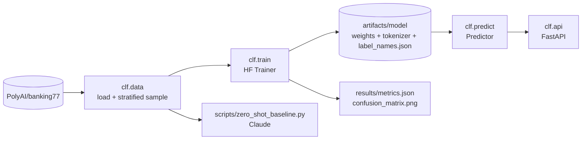

# text-classifier-finetune

Fine-tune DistilBERT for intent classification on Banking77, evaluate it, and serve it with FastAPI.

[](https://github.com/Muhaman/text-classifier-finetune/actions/workflows/ci.yml)

## What it does

- Fine-tunes `distilbert-base-uncased` on [PolyAI/banking77](https://huggingface.co/datasets/PolyAI/banking77) (77 customer-service intents) with the Hugging Face `Trainer`.
- Evaluates once on the test split and writes `results/metrics.json` plus `results/confusion_matrix.png`.
- Serves the saved model over HTTP (`POST /v1/predict`, `GET /healthz`).
- Ships a zero-shot Claude baseline script for comparison. See [MODEL_CARD.md](MODEL_CARD.md).

Training runs in the manual `train` GitHub Actions workflow (CPU runner), so no local GPU or install is needed.

## Architecture



## Quickstart

```bash
uv sync                       # CPU-only PyTorch wheels via the configured uv index
uv run python -m clf.train    # full run; add --epochs N or --sample 4000 for a quicker one
MODEL_DIR=artifacts/model uv run uvicorn clf.api:app
```

Or run training in GitHub Actions: Actions -> `train` -> Run workflow (inputs `epochs`, default 3, and `sample`, default 0 = full). The job uploads the model as an artifact and commits `results/`.

```bash
gh workflow run train.yml --repo Muhaman/text-classifier-finetune -f epochs=3 -f sample=0
```

## Usage / API

```bash
curl -s localhost:8000/v1/predict -H 'content-type: application/json' \
  -d '{"texts": ["my card has not arrived yet", "how do I change my pin"]}'
# {"predictions":[{"label":"card_arrival","score":0.97},{"label":"change_pin","score":0.99}]}
```

(Output above is illustrative of the response shape, not a measured result.)

- `texts`: 1 to 64 strings, each 1 to 512 characters; violations return `422` with `{"error": {"code": "validation_error", "message": ...}}`.
- The service refuses to start if `MODEL_DIR` has no trained model.
- Docker: `docker build -t clf . && docker run -p 8000:8000 -v "$PWD/artifacts/model:/models:ro" clf`.

Zero-shot baseline (needs `ANTHROPIC_API_KEY`; model from `ANTHROPIC_MODEL`, default `claude-opus-5-5`):

```bash
uv run --extra baseline python scripts/zero_shot_baseline.py --n 200
```

## Results

Pending: the full training run has not finished yet. The numbers will be copied from `results/metrics.json` once the `train` workflow completes.

## Design decisions & trade-offs

- **No validation split, no checkpoint selection.** Banking77 ships only train and test. The final-epoch model is used and the test split is evaluated exactly once, so the reported number is not tuned on test data.
- **Training in CI on CPU.** Slow but reproducible and free of local setup; PyTorch comes from the CPU wheel index to avoid CUDA downloads. DistilBERT with `max_len=64` and dynamic padding keeps a full run tractable.
- **Tiny model for tests.** Tests use `prajjwal1/bert-tiny` with a random 3-label head, so CI exercises the real load/predict/serve path in seconds without needing trained weights.
- **Sync predict endpoint.** Inference is CPU-bound; a plain `def` route runs in FastAPI's threadpool instead of blocking the event loop.
- **Stratified sampling with a per-class minimum.** `sample` keeps class proportions and at least one row per class, so quick runs never drop an intent.

## Testing

```bash
uv sync --all-extras --dev
uv run ruff check . && uv run ruff format --check . && uv run mypy src && uv run pytest -q
```

Tests cover metrics (accuracy and macro-F1), stratified sampling and label order, the predictor on a tiny saved model, and the API (validation limits, health, startup failure without a model).

## Limitations & next steps

- Single-label, English-only, one banking domain; no out-of-scope intent detection (low-confidence handling is left to callers via `score`).
- Scores are raw softmax probabilities and are not calibrated.
- No hyperparameter search; defaults only (lr 5e-5, batch 32, 3 epochs).
- Next: temperature scaling, an out-of-scope threshold, and ONNX export for faster CPU serving.

## License

MIT
